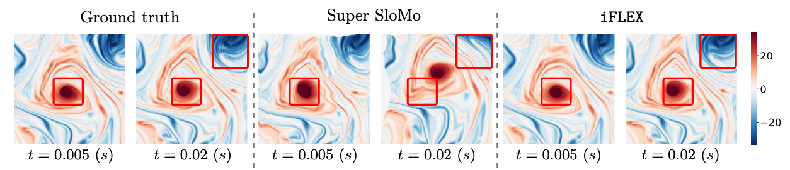

# :earth_americas: iFLEX: A Diffusion Model for Temporal Interpolation

> **[TMLR] Generative Refinement Learning for Temporal Interpolation in Scientific Machine Learning**
> 
> Pu Ren, Michael W. Mahoney, and N. Benjamin Erichson


This repository provides the official PyTorch implementation of **[iFLEX](https://openreview.net/forum?id=esqLKv6O2P)**. iFLEX is a rsearch code for temporal interpolation of physical fields using diffusion models. 


## Overview

iFLEX is a two-stage framework for temporal interpolation of scientific fields from sparsely sampled observations. It combines endpoint-consistent linear interpolation with conditional diffusion to reconstruct intermediate states between two observed snapshots. The first stage provides a linear reference, while the second learns the residual correction conditioned on both endpoint fields, the target interpolation time, the temporal interval, and available physical parameters. iFLEX supports arbitrary-time interpolation and is evaluated on turbulence, radar precipitation, and sea surface temperature datasets. The repository also includes UNet, SuperSloMo, EDEN, and linear interpolation baselines.


Below is an example of turbulence comparison between ground truth, baseline, and the iFLEX model. In these examples, iFLEX more closely reproduces the vortex structures in the ground-truth turbulence fields than Super SloMo. The panels compare the ground truth with reconstructions from Super SloMo and iFLEX at $t=0.005\,\mathrm{s}$ and $t=0.02\,\mathrm{s}$, using the same two endpoint observations. Red boxes highlight differences in vortex shape and fine-scale structures. Each intermediate field is reconstructed independently.

<p align="center">
  
</p>


## Supported datasets

| Dataset | Task | Data expected by the loaders |
| --- | --- | --- |
| NSKT | Turbulent flow interpolation and forecasting | HDF5 trajectories with a `w` array shaped `(time, height, width)` |
| Shanghai | Radar frame interpolation | An HDF5 file containing `train` and `test` groups with `all_len` and sample sequences |
| SST | Sea surface temperature interpolation | Regional NumPy fields, latitude/longitude arrays, and cached sequence indices |

Datasets and trained checkpoints will be released later.

## Installation

Create and activate a Python virtual environment, then install the dependencies from the repository root:

```bash
python -m venv .venv
source .venv/bin/activate
python -m pip install --upgrade pip
python -m pip install -r requirements.txt
```

Training entry points require NVIDIA GPUs and a CUDA-enabled PyTorch installation. Install a PyTorch/torchvision combination appropriate for your machine. The requirements list declares direct dependencies; it is not a tested, pinned environment lockfile.

Training uses Weights & Biases. Authenticate using `wandb login` or set `WANDB_API_KEY` in your environment. For local runs without uploading logs:

```bash
export WANDB_MODE=offline
```

## Data preparation

Defaults use `data/nskt/`, `data/sst/`, and `data/shanghai/shanghai.h5`, relative to the repository root. Place data there, symlink those locations to external storage, or pass another location through `--scratch_dir`. The `data/` directory is ignored by Git.

- **NSKT:** the current interpolation loader uses filenames such as `2000_2048_2048_seed_2150.h5`. Training/validation Reynolds numbers are 2000, 4000, 8000, 16000, and 32000, using seed 2150. Evaluation uses seed 3407 by default and supports additional Reynolds numbers. See `datasets/data_nskt_updated.py` for the complete lists and sampling logic.
- **Shanghai:** pass the path to the HDF5 file. See `datasets/data_shanghai.py` for group and sample layout. The current loader maps validation to the `test` group; account for this when interpreting validation-selected results.
- **SST:** pass the regional data root. See `datasets/data_sea_temp.py` for directory names, date parsing, temporal splits, and index-cache construction. Existing pickle caches should come from a trusted source.

## Training

Run commands from the repository root. Start with a base configuration and override the data path:

```bash
python train.py --config config/nskt/flex.yaml --scratch_dir /path/to/nskt
python train.py --config config/shanghai/flex.yaml --scratch_dir /path/to/shanghai.h5
python train.py --config config/sst/flex.yaml --scratch_dir /path/to/sst
```

The training entry points spawn one worker per visible GPU. Use `CUDA_VISIBLE_DEVICES` to select GPUs:

```bash
CUDA_VISIBLE_DEVICES=0 python train.py \
  --config config/nskt/flex.yaml \
  --scratch_dir /path/to/nskt \
  --batch_size 4
```

UNet and SuperSloMo use separate entry points:

```bash
python train_unet.py --config config/nskt/unet.yaml --scratch_dir /path/to/nskt
python train_super_slomo.py --config config/nskt/super_slomo.yaml --scratch_dir /path/to/nskt
```

For these training commands, precedence is **explicit command-line options > YAML values > parser defaults**. Post-training configurations may require an existing checkpoint; use the base configurations above for training from scratch. FLEX uses `--resume_training true` to retain the checkpoint epoch and optimizer state; the default finetuning path starts a fresh epoch schedule.

The shell scripts under `scripts/` use your active Python environment. Optionally set `CONDA_ENV_PATH` to a Conda environment name or absolute path; the EDEN benchmark uses `EDEN_CONDA_ENV_PATH`. Activate an environment with the appropriate dependencies before launching.

Checkpoint paths in configs and scripts are generic placeholders under `checkpoints/<dataset>/`. Supply a compatible trained checkpoint using `--checkpoint_path`, edit the YAML, or use the launcher's `CHECKPOINT_PATH` (some UNet launchers use `PRETRAINED_PATH` or `PRETRAINED_CHECKPOINT`). Training retains its generated checkpoint filenames; it does not automatically create these placeholder files. For example:

```bash
SCRATCH_DIR=/path/to/nskt CHECKPOINT_PATH=/path/to/model.pt \
  bash scripts/nskt/eval_flex_nskt.sh
```

Data overrides in shell launchers use `SCRATCH_DIR` or `DATA_PATH` where provided; config-based training can use a custom YAML through `CONFIG_PATH`. EDEN launchers default to the same repository-level data and checkpoint directories, while their config paths are relative to `EDEN/`; use absolute paths for custom EDEN overrides.

Slurm wrappers retain generic resource requests. Supply your own account, partition, and any required site options when submitting, and create `logs/` first. Adjust GPU/CPU counts and time limits for your cluster.

## Evaluation

For NSKT FLEX evaluation, provide a checkpoint and matching model configuration:

```bash
CUDA_VISIBLE_DEVICES=0 python eval.py \
  --config config/nskt/flex.yaml \
  --scratch_dir /path/to/nskt \
  --checkpoint_path /path/to/model_best.pt \
  --re_id 5 \
  --total_interp_steps 20 \
  --batch_size 4
```

Here `re_id=5` selects Re=12000 in the current evaluation list. `eval.py` supports YAML configurations and explicit CLI overrides, including a fallback from `total_interp_steps_train` to `total_interp_steps`.

Other evaluation entry points include `eval_shanghai_update.py`, `eval_sst.py`, `eval_super_slomo.py`, and `eval_linear_interpolation.py`. Their interfaces differ; consult `--help` and the corresponding scripts under `scripts/shanghai/`, `scripts/sst/`, and `scripts/nskt/`. Checkpoint architecture and conditioning settings must match the model being evaluated.

Metrics include relative Frobenius norm error (RFNE), R², and dataset-specific structural or radar scores. Available outputs depend on the entry point; metric files are written under `assets/`, and training writes checkpoints under `checkpoints/` and visualizations under `samples/`.

## Forecasting, ablations, and analysis

- `forecasting/` contains NSKT forecasting code, with configurations in `config/forecasting/` and launchers in `scripts/forecasting/`.
- `src/ablation/`, `config/ablation/`, and `scripts/ablation/` contain interpolation variants.
- `scripts/benchmark_inference_time.py` provides inference benchmarking.

**EDEN integration:** EDEN launchers and analysis hooks are included. The EDEN code can be found from [here](https://github.com/bbldCVer/EDEN).  


## Repository layout

```text
├── train.py / train_unet.py / train_super_slomo.py
├── eval*.py              # Dataset and baseline evaluation entry points
├── src/                  # Models, diffusion wrappers, metrics, and utilities
├── datasets/             # Loaders and preprocessing
├── forecasting/          # NSKT forecasting implementation
├── config/               # YAML experiment settings
├── scripts/              # Experiment launchers and benchmarks
├── tests/                # Lightweight regression checks
├── requirements.txt
└── LICENSE
```

## Validation and reproducibility

Run the lightweight configuration regression suite with:

```bash
python -m unittest discover -s tests -v
```

GPU training and evaluation require the matching datasets and checkpoints. Record package versions, GPU hardware, random seeds, data splits, and the exact configuration when reporting results. See [REVIEW.md](REVIEW.md) for the publication review and remaining limitations.


## Citation

If you find our research helpful, please consider citing our paper:

```bibtex
@article{ren_iflex,
  author = {Ren, Pu and Mahoney, Michael W. and Erichson, N. Benjamin},
  title = {Generative Refinement Learning for Temporal Interpolation in Scientific Machine Learning},
  journal = {Transactions on Machine Learning Research},
  year = {2026},
  url = {https://openreview.net/forum?id=esqLKv6O2P}
}
```


## License and acknowledgments

This repository is licensed under [GNU GPL v3](LICENSE). Retain applicable upstream attribution and licenses when distributing third-party code. The Shanghai loader cites DiffCast, and model components reference prior interpolation and diffusion implementations in their source files.


## Contact

If you have any questions or comments, please feel free to contact me through email (puren1028 AT gmail DOT com).